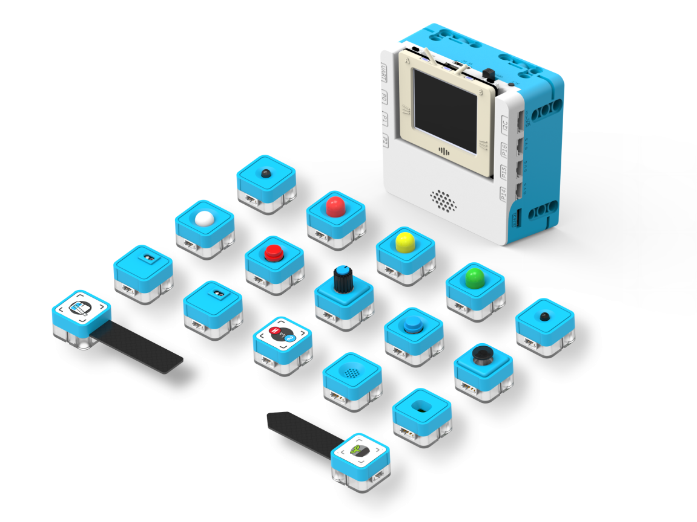

# sugarbox

Extension for Kittenbot Sugarbox




## Feature

This extension is designed to programme and drive the moudule series Sugar for micro:bit, You can [get Sugar From KittenBot](https://www.kittenbot.cc/collections/frontpage/products/micro-bit-sugar-series-creator-programming-educational-kit)


1. The first series of the Sugar electronic module system set consists of modules with various functions. Every module is fully covered by environmentally-friendly PC + ABS material and with good quality. 

2. It includes electronic modules that are often used in basic STEM education: digital input, digital output, analog input, analog output, etc.

3. The design of the module's ports has adopted the poka-yoke style, which solves the problem of students inserting the cables reversely in class and makes the project creation process much more efficient.

4. There are stickers on every module indicating the type of the module and the interface, which helps you distinguish each module easily.


## Basic usage

* Usage of digital input sensor

```blocks

    basic.forever(function () {
        if (Sugar.PIR(DigitalPin.P1)) {
            basic.showIcon(IconNames.Heart)
            basic.pause(2000)
            basic.clearScreen()
        }
    }) 

```

---

* Usage of digital output module

```blocks

    let light = 0
    input.onButtonPressed(Button.A, function () {
        Sugar.ledOnoff(DigitalPin.P1, Sugar.LEDSta.Off)
    })
    input.onButtonPressed(Button.AB, function () {
        light = 0
        for (let index = 0; index < 1023; index++) {
            Sugar.ledLuminent(AnalogPin.P0, 0)
            light += 1
        }
        for (let index = 0; index < 1023; index++) {
            Sugar.ledLuminent(AnalogPin.P0, 0)
            light += -1
        }
    })
    input.onButtonPressed(Button.B, function () {
        Sugar.ledOnoff(DigitalPin.P1, Sugar.LEDSta.On)
    })

```

---

* Usage of Analog input module

```blocks

    serial.redirectToUSB()
    basic.forever(function () {
        serial.writeValue("flame", Sugar.FlameAna(AnalogPin.P0))
        serial.writeValue("Light", Sugar.Light(AnalogPin.P0))
        serial.writeValue("Angle", Sugar.Angle(AnalogPin.P0))
        basic.pause(1000)
    })

```

---

* Usage of Analog i2c module

```blocks

    input.onButtonPressed(Button.A, function () {
        basic.showNumber(Sugar.TOFDistance())
    })
    input.onButtonPressed(Button.B, function () {
        basic.showNumber(Sugar.ENV(Sugar.EnvType.Temperature))
        basic.pause(500)
        basic.showNumber(Sugar.ENV(Sugar.EnvType.Humidity))
    })
    basic.forever(function () {
        led.unplot(0, 0)
        led.plot(Math.map(Sugar.joyValue(Sugar.DirType.X), -255, 255, 0, 4), Math.map(Sugar.joyValue(Sugar.DirType.Y), -255, 255, 0, 4))
        if (Sugar.joyState(Sugar.JoystickDir.pressed)) {
            basic.showIcon(IconNames.Happy)
            basic.pause(1000)
        }
    })

```

---

* Usage of Sugarbox Extension Board —— DC motor and servo

```blocks

    input.onButtonPressed(Button.A, function () {
        SugarBox.motorSpd(SugarBox.MPort.M1A, 255)
        SugarBox.motorSpd(SugarBox.MPort.M1B, 255)
        basic.pause(1000)
        SugarBox.motorStopAll()
    })
    input.onButtonPressed(Button.B, function () {
        SugarBox.servoPulse(SugarBox.SPort.S1, 500)
        basic.pause(1000)
        SugarBox.servoPulse(SugarBox.SPort.S1, 1500)
        basic.pause(1000)
        SugarBox.servoPulse(SugarBox.SPort.S1, 2500)
        basic.pause(1000)
    })
    SugarBox.waitready()

```

---

* Usage of Sugarbox Extension Board —— Encoder Motor

```blocks

    input.onButtonPressed(Button.A, function () {
        SugarBox.eMotorSetRpm(SugarBox.EPort.EM1, 240)
        basic.pause(1000)
        basic.showNumber(SugarBox.eMotorGetRpm(SugarBox.EPort.EM1))
        SugarBox.motorStopAll()
    })
    SugarBox.waitready()
    SugarBox.encMotorInit(SugarBox.EPort.EM1)


```


## Sugar thermal printer / 热敏打印机

积木位置：`Sugar → Advanced → 热敏打印机`。驱动位于 `sugarThermalPrinter.ts`，
由 `Sugar` 命名空间提供积木接口。

默认使用 micro:bit **TX=P0、RX=P1、115200 baud**；micro:bit TX 接打印机 RX，
micro:bit RX 接打印机 TX，并连接共地。首次调用也会按默认引脚自动初始化。
初始化会使用共享串口，不能同时与本扩展的 GPS、语音、MP3 等串口模块共用。

```typescript
Sugar.thermalPrinterInit(SerialPin.P0, SerialPin.P1)
Sugar.thermalPrinterConfigure(3000, 8, 24)
Sugar.thermalPrinterPrintText("你好，Sugar!", Sugar.ThermalPrinterAlign.Center, 2)
Sugar.thermalPrinterPrintText("第一行\n第二行")
Sugar.thermalPrinterNewline(1)
Sugar.thermalPrinterFeed(24)
// 可通过 Sugar.thermalPrinterLastResponse() 获取上次操作的原始响应。
```

- 文本以 UTF-8 发送，中文字形支持取决于打印机固件。支持左对齐、居中、右对齐和 1～4 倍缩放。
- 默认加热时间为 3000 微秒（范围 0～65535），行距 8 像素（范围 0～64），基础行高 24 像素（正整数）。
- 换行走纸距离为 `行数 × (基础行高 × 缩放 + 行距)`；走纸每像素对应 2 个电机步进，超过 16383 像素自动分段。
- 自动识别 `\n`、`\r\n`、`\r`。非空行分别打印，中间的空行走纸，末尾换行符不额外走纸，与源库一致。
- 单行 UTF-8 文本最多 3065 字节（总载荷上限 3072 字节，包含 7 字节参数），超长行不自动拆分。
- 默认等待 `DONE`、`ERR` 或超时。打印超时为 `3000 + 文本字节数 × 50` 毫秒，走纸超时为 `1000 + 分段像素数 × 10` 毫秒。
  上次响应保留原始内容，多行/分段响应依次拼接；超时保留已收到的内容，也可能为空，不自动重试。
- 展开积木可设置 `等待完成=false`，或在代码中调用 `Sugar.thermalPrinterPrintText("Hello", Sugar.ThermalPrinterAlign.Left, 1, false)`。
  此模式保持源库行为：发送命令后立即发送关闭电源帧，不读取完成响应，上次响应为空。
- 参数转为整数后检查范围。MakeCode 不使用 Python 的 `ValueError`，非法参数会停止程序并显示错误码 909。

底层类 `SugarThermalPrinter` 提供 `configure`、`printText`、`feed` 和 `newline`，后三者直接返回响应字符串。
`printText(text, align, scale, lineGap, heatUs, wait)` 也支持逐次覆盖行距与加热时间；省略时使用当前配置。
协议帧、校验和以及每条命令前开启电源、命令后关闭电源的顺序均沿用 MicroPython 驱动。

## 32×32 点阵转 bits 实验

在 `Sugar → Advanced → 点阵实验` 中拖出 `32×32 点阵转 bits（HEX）`，直接点击格子绘图。
将这个返回文本的积木接入 `串口 → 写入一行`，运行后在串口/模拟器控制台查看输出。

输出为连续的 256 个十六进制字符，代表 128 字节，不含宽高或协议头。
从上到下逐行处理，每行 4 字节；从左到右每 8 个像素打包为一个字节，高位在前，选中为 1。
例如只选左上角时，输出以 `80000000` 开头，其余为 0；只选右上角时以 `00000001` 开头。

代码中也可以直接调用 `Sugar.str2bits(text)`，把 MakeCode 的 `#` / `.` 点阵文本转换为 `Buffer`。
其中 `#` 为 1，`.` 为 0，忽略空格、制表符和换行；不包含宽高或协议头。
像素连续打包，不按行补齐，只有最后不足 8 位的字节在低位补 0；空输入或非法字符返回空 Buffer。

```typescript
let data = Sugar.str2bits("# . . . . . . #") // 一个字节：0x81
serial.writeLine(data.toHex()) // 显示 81
```

转换发生在程序运行时；切换到 JavaScript 时仍保留 `#` / `.` 点阵文本，
不会在绘图后自动将源码替换为 `hex` 字面量。源码位置：`sugarBitmap.ts`。

## 原尺寸打印 32×32 点阵

先使用 `热敏打印机 初始化` 设置串口，再在 `Sugar → Advanced → 热敏打印机` 中拖出
`热敏打印机 打印32×32点阵`，直接在积木上绘图，运行后打印。
默认串口仍为 TX=P0、RX=P1、115200 baud。

输出图案保持 **32×32 像素**，每个原始像素对应一个打印像素。现有方糖位图协议每行固定 384 像素，
因此图案居中放置，左右各留 176 个空白像素；32 表示输出图案宽度，不表示打印头行宽。
打印使用当前配置的加热时间，默认 3000 微秒。

JavaScript 也可调用 `Sugar.thermalPrinterPrintBits(data)`，其中 `data` 必须是代表 32×32 点阵的
128 字节 Buffer，可由 `Sugar.str2bits(text)` 生成，按行连续排列、高位在前。

位图命令为 `0x04`，载荷为小端 16 位加热时间及每行 48 字节位图。
每组发送 16 行，共 2 组；组间等待 `DONE`，收到 `ERR` 或超时后停止并关闭电源。
上次响应可通过 `Sugar.thermalPrinterLastResponse()` 查看，超时会追加 `ERR bitmap timeout`。
位图按原尺寸逐组填入协议行，不做缩放；该打印积木始终等待响应。

## License

MIT


## Supported targets

* for PXT/microbit
(The metadata above is needed for package search.)

```package
sugarbox=github:Kittenbot/pxt-sugar
```
