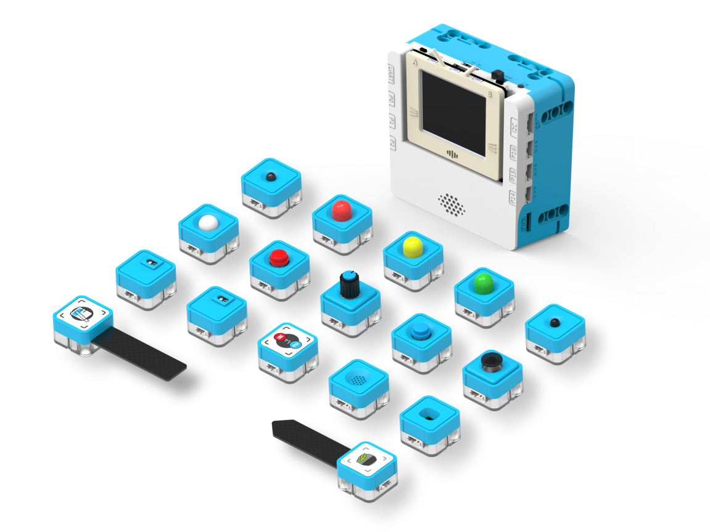

# sugarbox

Extension for Kittenbot Sugarbox




## Feature

This extension is designed to programme and drive the moudule series Sugar for micro:bit, You can [get Sugar From KittenBot](https://www.kittenbot.cc/collections/frontpage/products/micro-bit-sugar-series-creator-programming-educational-kit)


1. The first series of the Sugar electronic module system set consists of modules with various functions. Every module is fully covered by environmentally-friendly PC + ABS material and with good quality. 

2. It includes electronic modules that are often used in basic STEM education: digital input, digital output, analog input, analog output, etc.

3. The design of the module's ports has adopted the poka-yoke style, which solves the problem of students inserting the cables reversely in class and makes the project creation process much more efficient.

4. There are stickers on every module indicating the type of the module and the interface, which helps you distinguish each module easily.


## Basic usage

* Usage of digital input sensor

```blocks

    basic.forever(function () {
        if (Sugar.PIR(DigitalPin.P1)) {
            basic.showIcon(IconNames.Heart)
            basic.pause(2000)
            basic.clearScreen()
        }
    }) 

```

---

* Usage of digital output module

```blocks

    let light = 0
    input.onButtonPressed(Button.A, function () {
        Sugar.ledOnoff(DigitalPin.P1, Sugar.LEDSta.Off)
    })
    input.onButtonPressed(Button.AB, function () {
        light = 0
        for (let index = 0; index < 1023; index++) {
            Sugar.ledLuminent(AnalogPin.P0, 0)
            light += 1
        }
        for (let index = 0; index < 1023; index++) {
            Sugar.ledLuminent(AnalogPin.P0, 0)
            light += -1
        }
    })
    input.onButtonPressed(Button.B, function () {
        Sugar.ledOnoff(DigitalPin.P1, Sugar.LEDSta.On)
    })

```

---

* Usage of Analog input module

```blocks

    serial.redirectToUSB()
    basic.forever(function () {
        serial.writeValue("flame", Sugar.FlameAna(AnalogPin.P0))
        serial.writeValue("Light", Sugar.Light(AnalogPin.P0))
        serial.writeValue("Angle", Sugar.Angle(AnalogPin.P0))
        basic.pause(1000)
    })

```

---

* Usage of Analog i2c module

```blocks

    input.onButtonPressed(Button.A, function () {
        basic.showNumber(Sugar.TOFDistance())
    })
    input.onButtonPressed(Button.B, function () {
        basic.showNumber(Sugar.ENV(Sugar.EnvType.Temperature))
        basic.pause(500)
        basic.showNumber(Sugar.ENV(Sugar.EnvType.Humidity))
    })
    basic.forever(function () {
        led.unplot(0, 0)
        led.plot(Math.map(Sugar.joyValue(Sugar.DirType.X), -255, 255, 0, 4), Math.map(Sugar.joyValue(Sugar.DirType.Y), -255, 255, 0, 4))
        if (Sugar.joyState(Sugar.JoystickDir.pressed)) {
            basic.showIcon(IconNames.Happy)
            basic.pause(1000)
        }
    })

```

---

* Usage of Sugarbox Extension Board —— DC motor and servo

```blocks

    input.onButtonPressed(Button.A, function () {
        SugarBox.motorSpd(SugarBox.MPort.M1A, 255)
        SugarBox.motorSpd(SugarBox.MPort.M1B, 255)
        basic.pause(1000)
        SugarBox.motorStopAll()
    })
    input.onButtonPressed(Button.B, function () {
        SugarBox.servoPulse(SugarBox.SPort.S1, 500)
        basic.pause(1000)
        SugarBox.servoPulse(SugarBox.SPort.S1, 1500)
        basic.pause(1000)
        SugarBox.servoPulse(SugarBox.SPort.S1, 2500)
        basic.pause(1000)
    })
    SugarBox.waitready()

```

---

* Usage of Sugarbox Extension Board —— Encoder Motor

```blocks

    input.onButtonPressed(Button.A, function () {
        SugarBox.eMotorSetRpm(SugarBox.EPort.EM1, 240)
        basic.pause(1000)
        basic.showNumber(SugarBox.eMotorGetRpm(SugarBox.EPort.EM1))
        SugarBox.motorStopAll()
    })
    SugarBox.waitready()
    SugarBox.encMotorInit(SugarBox.EPort.EM1)


```


## Sugar thermal printer / 热敏打印机

积木位置：`Sugar → Advanced → 热敏打印机`。驱动位于 `sugarThermalPrinter.ts`，
由 `Sugar` 命名空间提供积木接口。

默认使用 micro:bit **TX=P0、RX=P1、115200 baud**；micro:bit TX 接打印机 RX，
micro:bit RX 接打印机 TX，并连接共地。首次调用也会按默认引脚自动初始化。
初始化会使用共享串口，不能同时与本扩展的 GPS、语音、MP3 等串口模块共用。

```typescript
Sugar.thermalPrinterInit(SerialPin.P0, SerialPin.P1)
Sugar.thermalPrinterConfigure(3000, 8, 24)
Sugar.thermalPrinterPrintText("你好，Sugar!", Sugar.ThermalPrinterAlign.Center, 2)
Sugar.thermalPrinterPrintText("第一行\n第二行")
Sugar.thermalPrinterNewline(1)
Sugar.thermalPrinterFeed(24)
// 可通过 Sugar.thermalPrinterLastResponse() 获取上次操作的原始响应。
```

- 文本以 UTF-8 发送，中文字形支持取决于打印机固件。支持左对齐、居中、右对齐和 1～4 倍缩放。
- 默认加热时间为 3000 微秒（范围 0～65535），行距 8 像素（范围 0～64），基础行高 24 像素（正整数）。
- 换行走纸距离为 `行数 × (基础行高 × 缩放 + 行距)`；走纸每像素对应 2 个电机步进，超过 16383 像素自动分段。
- 自动识别 `\n`、`\r\n`、`\r`。非空行分别打印，中间的空行走纸，末尾换行符不额外走纸，与源库一致。
- 单行 UTF-8 文本最多 3065 字节（总载荷上限 3072 字节，包含 7 字节参数），超长行不自动拆分。
- 默认等待 `DONE`、`ERR` 或超时。打印超时为 `3000 + 文本字节数 × 50` 毫秒，走纸超时为 `1000 + 分段像素数 × 10` 毫秒。
  上次响应保留原始内容，多行/分段响应依次拼接；超时保留已收到的内容，也可能为空，不自动重试。
- 展开积木可设置 `等待完成=false`，或在代码中调用 `Sugar.thermalPrinterPrintText("Hello", Sugar.ThermalPrinterAlign.Left, 1, false)`。
  此模式保持源库行为：发送命令后立即发送关闭电源帧，不读取完成响应，上次响应为空。
- 参数转为整数后检查范围。MakeCode 不使用 Python 的 `ValueError`，非法参数会停止程序并显示错误码 909。

底层类 `SugarThermalPrinter` 提供 `configure`、`printText`、`feed` 和 `newline`，后三者直接返回响应字符串。
`printText(text, align, scale, lineGap, heatUs, wait)` 也支持逐次覆盖行距与加热时间；省略时使用当前配置。
协议帧、校验和以及每条命令前开启电源、命令后关闭电源的顺序均沿用 MicroPython 驱动。

## 黑白画布与 bmp 图片打印

在 `Sugar → Advanced → 热敏打印机` 中使用“黑白图片”和“打印图片”积木。
点击图片缩略图打开 MakeCode 内置绘图编辑器，默认画布为 32×32，可修改图片尺寸。
画黑点，使用橡皮擦留白；图片携带宽高，无需填写数组或宽度参数。

```typescript
Sugar.thermalPrinterPrintBitmap(bmp`
    ....ffff....fff
    ....f..f....f.f
    ....ffff....fff
`)
```

`.` / `0` 表示留白，`f` 表示黑点；编辑器生成的其他非零像素符号也按黑点处理。
`bmp` 在编译时生成 1 位黑白 Buffer，宽度上限 384，原尺寸居中打印，沿用当前加热配置与分批等待机制。
这部分复用 MakeCode 自带编辑器和位图编译器，不依赖显示屏驱动或仅限 V2 的官方 `Bitmap` 运行库。
大图片仍受开发板可用内存限制。图片打印统一使用 bmp 黑白画布接口。

扩展提供项目级黑白调色板：内置编辑器保留 16 个色槽，所有非透明色槽均为黑色，擦除表示白纸。
因此同一项目的图片编辑器也会使用这套黑白配色。不要同时添加另一个定义全局 `bmp` 函数的扩展。

### 图片转 TS 小工具

运行 `tools/image_to_thermal_printer.py` 可选择本地图片，预览黑白效果，并复制 TS 代码或保存为 `.ts` 文件。
需要 Python 3.9 或以上版本（含 Tkinter），首次使用安装 Pillow：

```shell
python -m pip install -r tools/requirements.txt
python tools/image_to_thermal_printer.py
```

图片宽度超过 384 像素时默认等比例缩小，小图不放大；也可指定更小的最大宽度。
透明区域按白色处理，默认开启 Floyd–Steinberg 误差扩散抖动，在转换工具中用黑点疏密表现照片深浅。
文字和线稿可取消“照片抖动”，改用黑白阈值转换。
输出为 `bmp` 字面量，每一行对应图片的一行：`.` 留白，`f` 打黑点，不额外补齐字符或填写宽度。
把生成的图片打印代码粘贴到 MakeCode 的 JavaScript 编辑器中使用，
串口初始化和加热参数仍由项目中的积木设置。

## License

MIT


## Supported targets

* for PXT/microbit
(The metadata above is needed for package search.)

```package
sugarbox=github:Kittenbot/pxt-sugar
```
